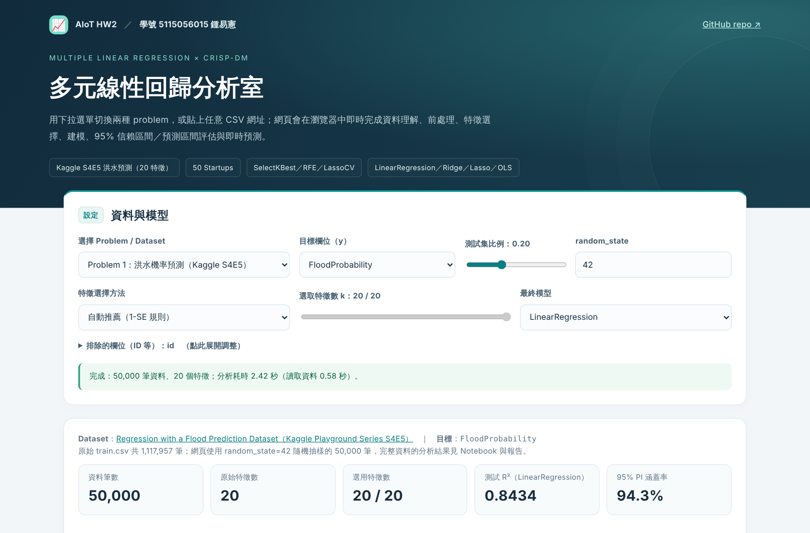
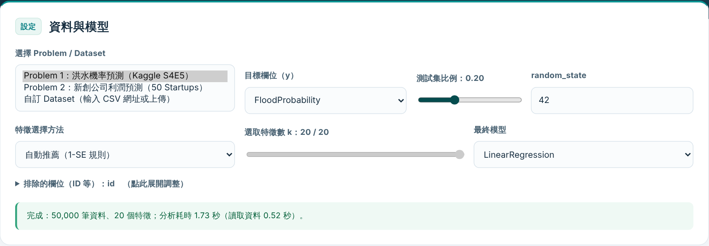
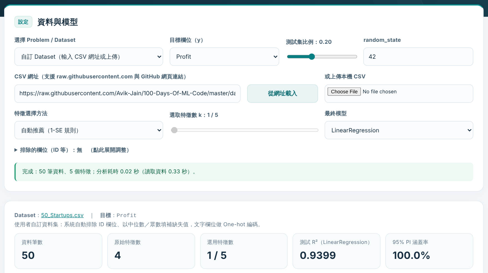
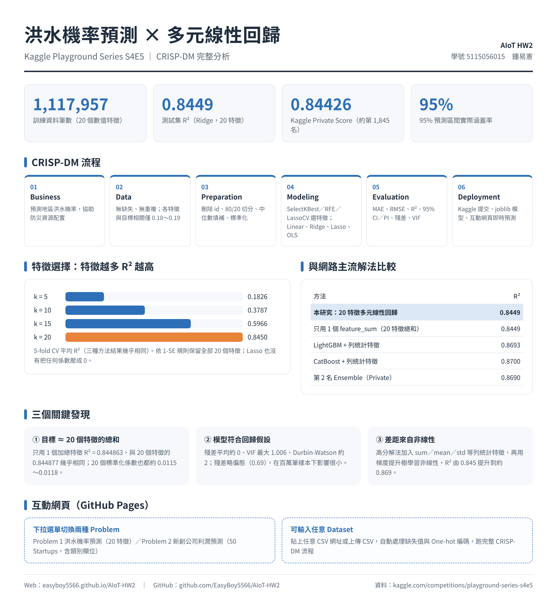
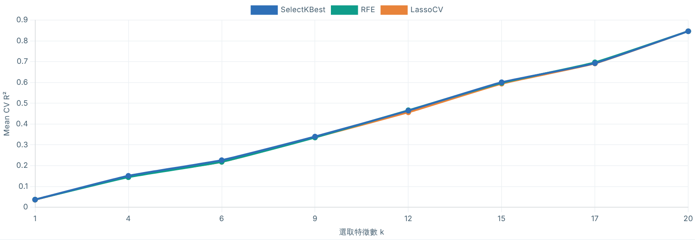
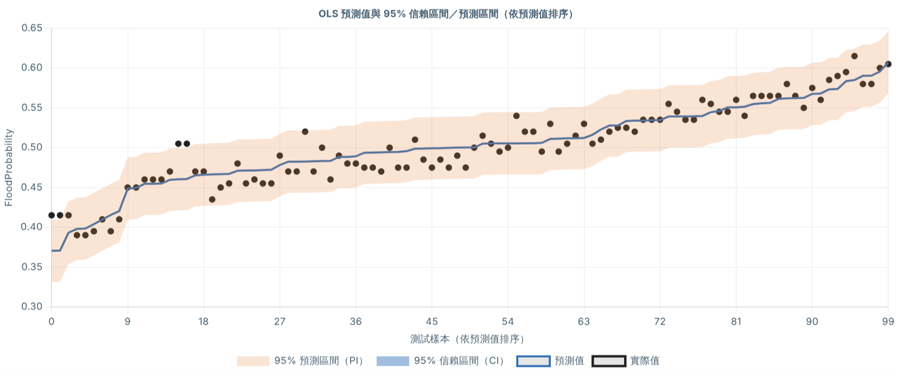

# AIoT HW2：多元線性回歸 × CRISP-DM

學號 **5115056015**　姓名 **鍾易憲**　課程：物聯網應用與資料分析

| 連結 | 網址 |
|---|---|
| 🌐 **Web（GitHub Pages）** | **https://easyboy5566.github.io/AIoT-HW2/** |
| 💻 GitHub | https://github.com/EasyBoy5566/AIoT-HW2 |
| 📓 Colab Notebook | https://colab.research.google.com/drive/10A_C9AQGlzaIKCIm9_LQPGAfKkzCIAzJ?usp=sharing |
| 📊 Kaggle 資料集 | https://www.kaggle.com/competitions/playground-series-s4e5 |



---

## 加分項完成情況

| 加分項 | 狀態 | 網頁上的位置 |
|---|---|---|
| **+1 分**：有下拉視窗呈現兩種 problem | ✅ | 頁面上方設定區的「選擇 Problem / Dataset」：Problem 1 洪水機率預測、Problem 2 新創公司利潤預測 |
| **+2 分**：可任意輸入 Dataset | ✅ | 下拉選「自訂 Dataset」→ 貼上任意 CSV 網址按「從網址載入」（也可上傳本機 CSV），再選目標欄位 |

<p>


</p>

自訂 Dataset 的處理方式：
- 支援 `raw.githubusercontent.com` 連結，也支援 GitHub 網頁連結（`github.com/.../blob/...` 會自動轉成 raw）
- 自動判斷 ID 欄位並排除（可在「排除的欄位」調整）
- 數值缺失值以訓練集中位數填補；文字欄位以眾數填補後做 One-hot 編碼（`drop_first`）；唯一值 > 30 的文字欄位不納入
- 預設目標為最後一個數值欄位，可在「目標欄位」改選
- 網頁在瀏覽器中執行，只能讀取允許跨網域存取（CORS）的網址，例如 `raw.githubusercontent.com`；其他來源可下載後用「上傳本機 CSV」

已測試：老師範例 [50_Startups.csv](https://raw.githubusercontent.com/Avik-Jain/100-Days-Of-ML-Code/master/datasets/50_Startups.csv)、seaborn 的 `mpg.csv`（含缺失值與文字欄位）。

---

## 網頁技術：純 JavaScript（與 DIC2 相同做法）

- 網頁只有 `index.html` + `js/` + `vendor/`（Chart.js、PapaParse），部署在 GitHub Pages，不需要伺服器，也不需要下載 Python。
- **速度**：洪水資料 50,000 筆 × 20 特徵，從開啟到完成全部分析約 2～3 秒；50 Startups 與自訂小型資料集不到 0.1 秒。
- 回歸運算（`js/stats.js`）全部以充分統計量（Σx、Σxxᵀ、Σxy）計算，交叉驗證與特徵選擇只需 O(p²) 運算。
- **與 Python 交叉驗證**：在相同的訓練／測試切分與 CV 折下，和 scikit-learn／statsmodels 比對：

| 項目 | 差異 |
|---|---|
| OLS 係數、標準誤、p-value、R²、Adjusted R² | 相對誤差 < 1e-10 |
| 95% 信賴區間／預測區間、涵蓋率 | 完全相同（小數 8 位） |
| Ridge（GCV 選 α）、Lasso（CV 選 α） | α 與測試 R² 相同（Lasso 差 < 1e-5） |
| SelectKBest、RFE 的 CV R² | 完全相同 |
| LassoCV 排名的 CV R² | 差 < 0.006（係數幾乎相同的特徵，排序受收斂精度影響） |
| VIF、Breusch-Pagan、Durbin-Watson、偏態、峰度 | 完全相同 |

---

## 資訊圖表



---

## 兩種 Problem

| | Problem 1：洪水機率預測 | Problem 2：新創公司利潤預測 |
|---|---|---|
| 資料集 | [Kaggle Playground S4E5](https://www.kaggle.com/competitions/playground-series-s4e5) | [50 Startups](https://raw.githubusercontent.com/Avik-Jain/100-Days-Of-ML-Code/master/datasets/50_Startups.csv) |
| 筆數 | 1,117,957（網頁使用 50,000 筆抽樣） | 50 |
| 特徵 | 20 個數值特徵 | 3 個數值 + 1 個類別（State） |
| 目標 | `FloodProbability` | `Profit` |

---

## CRISP-DM 流程（網頁 7 個分頁）

1. **Business Understanding**：定義問題、商業價值、成功標準與限制
2. **Data Understanding**：前 10 筆資料、欄位型態與缺失值、描述統計、目標分布、相關係數熱力圖
3. **Data Preparation**：排除 ID、刪除重複與目標缺失、80/20 切分、中位數／眾數填補、One-hot 編碼、標準化（放在 Pipeline 內避免資料洩漏）
4. **Modeling**
   - **Feature Selection**：比較 SelectKBest（f_regression）、RFE（LinearRegression）、LassoCV，不同 k 值的 5-fold CV R²，以 **1-SE 規則**自動推薦特徵組合（也可手動選方法與 k）
   - **模型**：LinearRegression、Ridge（GCV 選 α）、Lasso（CV 選 α）、OLS（係數、標準誤、p-value、95% 係數信賴區間，等同 statsmodels）
5. **Evaluation**：MAE、MSE、RMSE、R²、Adjusted R²；**預測圖加 95% 信賴區間與預測區間**；實際 vs 預測、殘差圖、殘差分布、Q-Q Plot；五大回歸假設檢查（線性、殘差平均為 0／常態性、Durbin-Watson 獨立性、Breusch-Pagan 等變異性、VIF 共線性）
6. **Deployment**：輸入特徵值即時預測（附 95% CI 與 PI），可下載測試集預測結果 CSV
7. **網路解法與 AI 輔助**：網路主流解法比較、NotebookLM 摘要、GPT 輔助內容

<p>


</p>

---

## 主要結果（Problem 1，完整 1,117,957 筆，見 Notebook）

| 指標 | 結果 |
|---|---|
| 特徵選擇（三種方法 + 1-SE 規則） | 保留全部 20 個特徵，5-fold CV R² = 0.844959 |
| 測試集 R²（Ridge） | 0.844877 |
| 測試集 RMSE / MAE | 0.020080 / 0.015792 |
| 95% 預測區間涵蓋率（抽樣 100 筆） | 95% |
| 最大 VIF | 1.0058（無共線性） |
| 特徵加總實驗：只用 `feature_sum` 1 個特徵 | R² = 0.844863（與 20 特徵幾乎相同） |
| **Kaggle 分數** | Public 0.84458 / Private 0.84426（賽後提交，Private Leaderboard 約第 1,845 名） |

Problem 2（50 Startups）：1-SE 規則只選出 `R&D Spend` 一個特徵，測試 R² 約 0.93～0.94（依切分而定），代表研發支出是預測利潤最關鍵的變數。

---

## 網路主流解法比較

| 方法 | 代表成績 | 優點 | 限制 |
|---|---|---|---|
| 本研究：20 特徵多元線性回歸 | 測試 R² 0.8449；Kaggle Private 0.84426 | 訓練快、係數可解釋 | 無法捕捉非線性 |
| 特徵加總 + 線性回歸 | R² 0.8449（1 個特徵） | 證實目標主要由特徵總和決定 | 與原始特徵同用會完全共線 |
| LightGBM / CatBoost + 列統計特徵 | CV R² 約 0.869～0.870 | 學習非線性與交互作用 | 需調參、可解釋性低 |
| Ensemble（第 2 名解法） | Private 0.86902 | 降低單一模型誤差 | 訓練與維護成本高 |

## NotebookLM 摘要

參賽者主要使用梯度提升樹模型（CatBoost、LightGBM、XGBoost），並結合線性模型與模型融合（Blending／Ensemble）提升表現。特徵工程是拿高分的關鍵，最核心的做法是跨特徵的列統計量，例如每筆資料 20 個特徵的總和、平均值、標準差、中位數、偏度與熵。加入進階列統計特徵後，CatBoost 單模 CV R² 達 0.87003，LightGBM 約 0.86931。線性回歸的優點是訓練極快，只用特徵總和就能得到約 0.844～0.846 的基準分數；缺點是無法捕捉非線性與特徵交互作用，因此上限受限。（完整畫面：[docs/NotebookLM_summary.pdf](docs/NotebookLM_summary.pdf)）

## GPT 輔助內容

使用 ChatGPT 依 CRISP-DM 各階段協助撰寫 Colab 程式與整理網路解法，所有數值皆為實際執行結果；網頁程式（`index.html`、`js/`）與 Python 版 `app.py` 由 AI 協助撰寫，網頁的回歸運算已與 scikit-learn／statsmodels 逐項核對。完整對話紀錄：[docs/GPT_conversation.pdf](docs/GPT_conversation.pdf)

---

## 檔案結構

```
AIoT-HW2/
├── index.html                      # 網頁（主要繳交，GitHub Pages）
├── js/
│   ├── stats.js                    # 回歸運算核心：OLS、Ridge、Lasso、CV、CI/PI、VIF、BP 檢定
│   ├── analysis.js                 # CRISP-DM 流程：前處理、特徵選擇比較、模型訓練、診斷
│   └── app.js                      # 介面、表格與圖表
├── vendor/                         # Chart.js 4.4.7、PapaParse 5.4.1
├── app.py                          # Python／Streamlit 版本（同樣功能，選用）
├── requirements.txt                # app.py 所需套件
├── 5115056015_hw2.ipynb            # Colab 主程式（完整 111 萬筆資料，含所有輸出）
├── data/
│   ├── flood_train_sample.csv.gz   # Kaggle S4E5 train.csv 抽樣 50,000 筆（random_state=42）
│   └── 50_Startups.csv
├── models/
│   └── flood_prediction_model.joblib   # Notebook 訓練的最終 Ridge Pipeline
├── docs/
│   ├── 5115056015_hw2_report.pdf   # 完整報告（含 GPT 對話附錄）
│   ├── GPT_conversation.pdf        # ChatGPT 對話紀錄
│   └── NotebookLM_summary.pdf      # NotebookLM 研究摘要
└── images/                         # 資訊圖表與 README 截圖
```

## 本機執行

網頁版（純 JavaScript）：

```bash
python -m http.server 8000
# 開啟 http://localhost:8000/
```

Python／Streamlit 版（選用）：

```bash
pip install -r requirements.txt
streamlit run app.py
```
